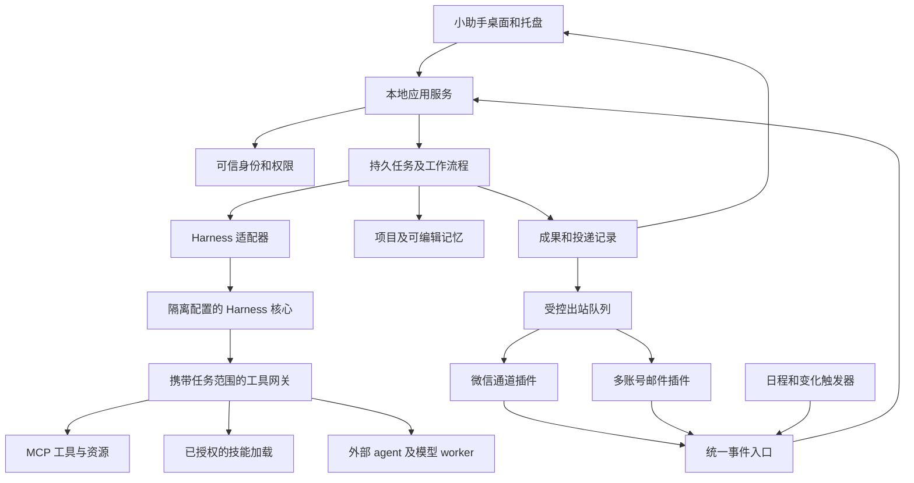

# 小助手系统架构与扩展规范

设计版本：2026 年 10 月 25 日。本文件中的目录、接口和数据结构属于拟建的小助手应用规范，不代表当前工程已经实现，也不自动等同于 Harness 或 MCP 的现有接口。真实外部 API 通过适配器与兼容测试固定。

## 核心架构决定

采用 Windows 桌面应用加本地应用服务的结构。新产品层使用 TypeScript，桌面壳优先 Electron，复用现有网页界面和 Node 代码；已有 Python 电脑工具与 C# 合同引擎保留为独立进程。首版使用 SQLite 保存产品数据，文件产物存储在可配置的用户数据目录。避免在首版引入多台服务、云数据库或独立向量服务。

Harness 继续负责 AI 执行核心。小助手拥有稳定产品身份、账号、项目、任务和权限；Harness 保存其原生执行会话与日志。二者通过执行会话映射和事件引用关联。小助手不直接改写 Harness 的原生会话文件，也不重新实现它的工具推理循环。



桌面界面和通信通道都不能绕过应用服务直接赋予权限。插件故障不应拖垮其他通道。邮件收取是确定性服务，AI 摘要是独立后续任务；引擎离线时仍可同步与保存邮件。

## 建议目录与迁移方式

在同一个 Git 工程中增量引入以下目录，旧 `代码/项目` 暂时保持原位，避免一次性移动破坏导入和现有运行环境。

```text
小助手/
  apps/
    desktop/                 Electron 主进程、preload、界面
    service/                 单实例应用服务、任务、账号、状态接口
  packages/
    contracts/               事件、任务、插件、产物等数据契约
    runtime-harness/          唯一 Harness 接口及版本适配
    policy/                   身份、授权、预算、审计
    storage/                  SQLite 迁移、仓库、备份恢复
    task-engine/              工作流程、重试、检查点、取消
    capability-registry/      工具、技能、流程和 worker 目录
    mcp-gateway/              可信上下文传播及 MCP 接入
    skill-manager/            发现、验证、版本与能力匹配
    worker-manager/           agent/模型调用与结果交接
    artifact-store/           文件产物、来源、预览和版本
    memory/                   主人、会话、项目与成员的隔离记忆
  plugins/
    wechat/                   包装现有适配器与解析逻辑
    mail/                     多账号与 IMAP、Gmail、Graph 适配
    files-browser/            本地文件及受控浏览器能力
    contract/                 完整恢复后的合同 MCP
    document/                 材料、Word、PDF、表格等工具
    literature/               检索源与引文元数据工具
    scheduler/                计划、静默时段、事件规则
  skills/                     经过移植验证的独立技能包
  workflows/                  带版本的可复用工作流程
  config/examples/            无密钥配置及账号导入样例
  tests/                      模拟通道、契约、关键回归和端到端
  scripts/                    构建、开发、迁移和诊断入口
  docs/                       架构、任务、验收与来源清单
  代码/                       迁移期的原项目资产
```

生产数据默认在当前 Windows 用户的应用数据目录下，可在初次设置中迁到 G 盘。建议逻辑布局：`db/assistant.sqlite`、`artifacts/`、`projects/`、`plugins/`、`skills/`、`harness-home/`、`logs/`、`backups/`。路径全部由配置和系统 API 解析，禁止把开发者用户名和盘符写进默认代码。微信数据库保留在原位置，通过授权只读访问，不整库复制进 Git 或默认知识库。

## Harness 接入与版本策略

新产品只依赖 `runtime-harness`，不在邮件、界面和工作流程中散落 `ctx.agents`、`.dsh` 或 app.asar 路径。T01 先记录本机安装方式、确切版本、受支持入口和插件 API，再决定可用版本组合。

公开上游已经提供 SDK 驱动运行时、独立 home、会话恢复及插件能力。拟采用 TypeScript SDK 驱动隔离的 `sdk` 配置；必须以选定发布版本实测，不能把上游 master 的功能当作本机已具备。参考 [Harness CLI](https://github.com/deepseek-ai/deepseek-harness/blob/master/apps/cli/README.md)、[TypeScript SDK](https://github.com/deepseek-ai/deepseek-harness/blob/master/packages/sdk/client/README.md)。

接入按如下顺序决定：

1. **首选**：固定可用版本的受支持 SDK/CLI，使用小助手专属 DSH_HOME、profile 和经过版本锁定的插件。
2. **兼容过渡**：若当前版本不满足新 SDK，继续通过现有社交桥插件接入，但将其包在同一 RuntimePort 后，标记功能限制并保持配置隔离。
3. **停止条件**：审批、工具隔离、会话恢复或任务归属无法可靠表达时，不宣称已支持相应能力；先调整 profile 或适配版本，再开放该功能。

关闭 Harness 桌面窗口与停止 Harness 核心是两回事。产品目标是无需用户操作额外桌面窗口，运行时可以作为受管理的后台子进程。升级或配置迁移不得改动用户现有个人 Harness home。

拟建应用接口示意：

```ts
interface RuntimePort {
  inspect(): Promise<RuntimeCapabilities>;
  createSession(input: SessionSpec): Promise<ExecutionSessionRef>;
  resumeSession(ref: ExecutionSessionRef): Promise<void>;
  run(input: TurnSpec): AsyncIterable<ExecutionEvent>;
  cancel(runId: string): Promise<CancelOutcome>;
  closeOwnedRuntime(runtimeId: string): Promise<void>;
}
```

RuntimeCapabilities 必须描述版本、流式事件、图片、恢复、审批、技能、MCP、计费信息和取消粒度。适配器负责把外部事件转成产品事件，保留原始事件引用，禁止从 stderr 文本猜“任务完成”。

当前上游 SDK 文档还注明中途取消的粒度限制；设计不能假设总有单 turn 取消方法。需要取消隔离的任务使用独立或可专属关闭的 runtime，关闭后记录可能未完成的外部动作；不能因为终止一个任务而误杀其他运行实例。相关限制以选定版本验证。

AI 会话原始日志由 Harness 持有。产品库保存 `productConversationId → harnessHomeId/profile/sessionId`、关联任务和事件游标。产品删除记录时按范围清理双方数据；原始日志不能被摘要完全替代。

## 人格与连续身份

产品保存唯一的助手身份、核心人格、称呼偏好和版本历史。渠道可以选择表达风格、群聊礼仪和专业角色，但工作角色只改变当前任务的处理方式，不覆盖核心身份。角色正文、权限策略、项目事实和外部资料分别组织，不把所有内容拼成一段难以维护的系统提示。

人格由 RuntimePort 在正确的上下文层注入，变更留版本并作用于下一轮。更换模型、重启程序或压缩上下文后，仍使用相同产品身份和获准记忆。技能、邮件和网页不能重写人格与权限。长期记忆保留来源，摘要不能把推断变成事实。

用户可以导出、编辑和恢复人格，查看她记住了什么。任务执行时保持自然交流，并明确区分“正在做”“已经生成”“已经提交发送”与“仍待核验”，人格表达不能掩盖执行状态。T09 负责人格注入与恢复，T15 提供设置入口，T26 管连续记忆。

## 身份和权限模型

必须分开主人、账号、外部联系人、会话、任务及 worker。桌面主人身份通过本机产品配置建立；微信身份来自经过校验的通道事件；发件邮箱、网页和附件中的名字不能据此变成主人。

入站统一事件至少包含：

```ts
type AssistantEvent = {
  eventId: string;
  source: 'desktop' | 'wechat' | 'mail' | 'schedule' | 'worker';
  accountId: string;
  conversationId: string;
  externalMessageId?: string;
  actorRef: string;
  occurredAt: string;
  receivedAt: string;
  trust: 'owner-command' | 'contact-content' | 'external-data';
  contentRefs: string[];
  replyTarget?: ReplyTarget;
};
```

可信字段由入口适配器和本地服务生成，不接受模型传入的同名字段覆盖。replyTarget 绑定精确账号与通道对象标识，显示名只用于界面显示。跨账号聚合邮箱不意味着跨账号共享写权限。

授权对象采用 `主体 + 动作 + 资源 + 条件 + 有效期`。例如：主人可在采购项目中读取已添加的报价目录、生成草稿到指定输出目录；某微信私聊可执行“查询任务状态”；某 worker 只能读取本任务的三份脱敏附件。

工具定义对模型的可见性和执行端授权必须同时生效。权限在调用时检查，长期任务在恢复、委托与最终投递前再次检查；撤销授权后尚未执行的步骤停止。Skill、网页和工具返回值都不能扩大授权。

内置 shell、文件与网络工具也必须受相同范围约束。只保护 MCP 而仍让同一 agent 任意读凭据或执行 shell，无法实现权限边界。社交会话使用受限 preset；执行型 worker 使用隔离工作区、受限 Windows 账号或 ACL 等实际隔离方式。Windows Job Object 管生命周期和资源，不把它等同于文件或网络沙箱。MCP 插件进程和系统工具默认视作受信执行代码，按其真实隔离能力标记。

## 任务与工作流程

Task 保存目标和用户可理解的状态，Attempt 保存一次实际执行。每个任务绑定来源事件、项目、执行会话、权限版本、预算、截止时间、目标产物和出站目标。

状态建议为 `queued → running → waiting_input / waiting_authorization / waiting_dependency → validating → succeeded / failed / cancelled / interrupted`。产物已生成但投递失败时，工作状态与 Delivery 状态分开显示。工作流程可设置“完成定义要求投递成功”；不能只显示一个含混的成功标记。

使用 SQLite 事务保存任务与事件，再由 worker 领取租约。每个执行步骤有幂等键、尝试次数、检查点、超时和资源范围。默认限制后台 AI 并发，外部服务分别限流；具体值在设置中可见。

任务重启后分三类恢复：可安全重做的查询进入重试；已有产物从检查点继续校验或投递；发生外部发送且回执不明的步骤进入 `delivery_unknown`，先查询回执或交给主人处理，不盲目重发。

同一流程的确定性步骤直接调用工具，不每一步都请求模型。可让 AI 在需要规划、提取或写作时介入，随后由程序检查金额、字段、文件、收件人和引用等约束。流程允许有条件分支和人工补充，限制最大步数与递归委托深度。

## 成果与出站投递

产物结构包括 artifactId、taskId、projectId、版本、MIME、大小、SHA-256、保存位置、来源、校验结果和敏感等级。每个任务使用独立目录；禁止根据外部 agent 的任意路径直接发送文件。外部成果先导入、检查类型与范围，再登记到成果库。

Outbox 是所有微信消息、文件和邮件发送的必经出口，保存目标、内容版本或哈希、授权依据、幂等键、提交时间、服务回执与重试状态。发出前再次核对当前目标和内容。工具“接受发送”、平台“提交成功”和可证明的送达分开表达；邮箱 SMTP 的接受不等同于收件人阅读，也无法承诺端到端严格一次投递。

现有 social-engine 和 media-outbox 中的去重、限流和回执逻辑应先包装接入，不能直接删掉后只靠全新简易队列。最终建立一种跨通道的数据契约，通道自身保留必要协议细节。

## MCP 接入设计

MCP 提供工具与资源接口；应用插件还承担账号登录、后台同步、界面和生命周期。一个完整的邮箱插件可以暴露 MCP 工具，但不能只装一个 MCP 就认为多账号产品功能已经完成。

对普通工具通信复用 Harness 的 MCP 客户端，避免再写一套协议栈。小助手管理服务器清单、版本、账号与权限，并通过受信 profile 或工具网关把本任务可用工具交给 Harness。需要专门 UI 的账号测试可以复用同一连接管理层，不另开一个不受管理的服务器副本。具体原生客户端配置以选定版本为准；[官方客户端文档](https://github.com/deepseek-ai/deepseek-harness/blob/master/packages/mcp/mcp-client/README.md)提供接入参考。

服务器的 instructions、工具说明和返回正文都需要明确来源。当前上游客户端可能把服务器 instructions 加入模型上下文，因此只允许经过接入审查的服务器进入受信 profile，限制大小并检查冲突；不能把第三方文字等同于用户授权。账号或资源范围仍由真实执行端限制，单靠提示词无法形成权限边界。

接入顺序为：获取并核对来源 → 安装固定版本 → 静态权限预检 → 启动并握手 → 查看工具与资源清单 → 测试调用 → 绑定账号和资源范围 → 启用 → 监控 → 更新或回退。安装外部服务器意味着执行代码，不能在每次普通聊天中临时运行不固定版本的 `npx -y`。

本地优先 stdio，远程使用带鉴权的 Streamable HTTP。历史 SSE 作为显式兼容能力；协议版本与 SDK 固定并实测，不简单回显客户端版本。校验 Origin、Host、重定向、目标地址、超时和大小限制，凭据通过安全引用注入。[MCP 传输规范](https://modelcontextprotocol.io/specification/2025-11-25/basic/transports)是协议基线之一，选定的新版本另做兼容测试。

拟建插件描述示例，属于小助手规范：

```json
{
  "id": "mail",
  "version": "0.1.0",
  "pluginApi": "1",
  "kinds": ["account-provider", "event-source", "mcp-provider"],
  "entry": "./dist/main.js",
  "permissions": ["mail.read", "mail.draft", "artifact.create"],
  "mcp": { "serverId": "assistant-mail", "transport": "stdio" },
  "dataScope": "per-account",
  "secretRefs": ["account-auth"],
  "capabilities": ["mail.sync", "mail.search", "mail.attachment", "mail.draft"]
}
```

描述清单不是授权本身；每个实例还有实际授权和账号绑定。插件需要 install、start、health、stop、upgrade、rollback 生命周期；停用时先停止事件和排程，保存游标并安全结束自己拥有的子进程。热更新失败时回到上一个可用版本。

第一批工具组建议如下，工具名是拟建应用名，不要求重命名已有协议标识：

| 组 | 代表能力 | 默认授权范围 |
| --- | --- | --- |
| 系统与文件 | 检查服务、列目录、有界读取、生成新文件、导入成果 | 指定项目与文件夹 |
| 微信 | 状态、接收、查询回执、发送消息与文件 | 白名单账号与会话 |
| 邮件 | 列账号、同步、搜索、读取、附件、草稿、显式发送 | 每账号区分读、写和发送 |
| 合同 | schema、资料核对、preview、generate、模板库 | 主人指定采购项目 |
| 文档 | Word、PDF、表格、演示稿的生成与预览 | 当前任务资料与输出目录 |
| 文献 | 检索、元数据核验、合法全文入口、引文导出 | 选定来源及下载目录 |
| 项目与记忆 | 项目状态、待办、读取与提议新增记忆 | 主人、项目、会话分别隔离 |
| 委托 | 列 worker、提交子任务、读状态、取消与成果导入 | 父任务授权的子集 |
| 调度 | 创建或取消提醒、检查变化、查询计划 | 用户明确要求或已建立的规则 |

工具结果统一转换为 ToolOutcome：`ok / errorCode / retryable / summary / data / artifactRefs / sideEffects / receipt`。校验 Schema、分页、最大输出和错误映射；工具错误不能只藏在“成功返回”的中文字符串中。resources 复用有界读取；MCP prompts、sampling、elicitation 等扩展只有客户端与策略实际支持才开放。

## Skill 使用与迁移

Skill 规定做事方法，MCP 提供实际动作。采用带 YAML 元数据的 `SKILL.md` 目录，正文按需加载，references、assets 和 scripts 按任务读取。小助手自建扩展元数据记录 requiredCapabilities、工具依赖、产物类型、支持的执行器与验证方法；这些是应用元数据，不冒充通用规范的必需字段。结构依据 [Agent Skills 规范](https://agentskills.io/specification)。

发现与加载复用 Harness 的技能能力，但只将产品批准的目录提供给当前执行 scope，不能默认扫描并开放用户电脑所有 agent 的技能库。对来源、版本、脚本依赖、绝对路径和工具名做移植检查。Harness 的具体根目录、缓存与监视行为参考[文件系统技能提供器](https://github.com/deepseek-ai/deepseek-harness/blob/master/packages/skill/skill-filesystem/README.md)，以固定版本验收。

宿主 Codex 中可用的 skill、连接器、内置浏览器或渲染工具，不会自动出现在独立小助手里。可移植的是经过授权的指令、脚本和模板；依赖宿主 API 的部分必须实现替代适配或标记不支持。不能通过复制 `SKILL.md` 宣称已经接入 Word、检索、图像生成或完整 agent 能力。

首批技能与验收：

| 技能 | 必要工具 | 输出与核验 |
| --- | --- | --- |
| mail-triage | mail.read/search、项目任务 | 带邮件来源的事项，去重并区分建议和事实 |
| contract-drafting | 合同 schema、preview、generate、资料库 | Word 草稿、确定金额和缺项表，固定条款不被随意改动 |
| material-writing | 来源读取、文档与预览 | 可编辑材料、事实来源、待补字段和版面预览 |
| literature-search | 学术检索与元数据 | DOI/其他标识、来源、去重、摘要范围说明 |
| literature-review | 阅读、引用核验、文档或 TeX/PDF 工具 | 论点与来源对应；读不到全文不假装精读 |
| project-followup | 项目库、任务、日程 | 具体下一步、责任与时间；不重复提醒 |
| file-organization | 文件清单、预览移动计划、受控操作 | 移动记录与可回退计划；原件不被无依据覆盖 |
| task-review | 产物读取与校验 | 与验收标准对应的问题和修订建议 |

选择技能时先按意图与能力依赖过滤，再读取正文。技能中引用的工具不存在时说明缺口；技能不能自行安装服务器或提升权限。使用一次工作总结生成新技能属于草稿流程，测试通过后才进入启用目录。

当前开发环境已有丰富的技能目录，可作为后续移植候选。下表按其已声明用途组织，不代表已在小助手中安装或通过验收；T16 逐个检查正文、运行依赖和授权范围后决定采用。

| 现有候选 | 可迁入的工作方法 | 必须补齐或替换的依赖 |
| --- | --- | --- |
| literature-search、nature-academic-search、nature-ref-verifier | 多源检索、元数据与引文核验 | 小助手自己的检索 API、参考文献库和凭据管理 |
| nature-reader、nature-paper-card | 论文阅读、证据拆解与精读卡 | 合法全文获取、PDF 解析、图表与引用定位 |
| lit-review、deep-lit-review、deep-deep-lit-review | 不同深度综述与研究方向分析 | 文献工具、长任务检查点、TeX/PDF 构建及版面验证 |
| nature-writing、nature-polishing、researchwrite | 材料与论文结构、写作、润色和研究计划 | 用户事实资料、文档工具和来源记录 |
| nature-figure、nature-paper2ppt | 科研图表与汇报 | 独立 Python/R、绘图库、PPTX 工具与渲染 |
| documents、pdf、spreadsheets、presentations | 办公文件的生成、修改与预览方法 | 独立可安装运行时；宿主专有工具需要重做适配 |
| nature-experiment-log、lecture-transcript-to-physics-pdf | 实验记录与讲义整理 | 转写来源、公式与参考材料核验、对应输出工具 |
| skill-creator | 把成熟工作方法整理成技能 | 独立验证器、脚本依赖检查、版本与安装流程 |

合同技能优先从现有合同引擎的 schema、preview 约束与业务样例建立，不能直接拿通用写作技能自由生成固定条款。需要外部服务的技能在缺少登录、模型或接口时显示不可用依赖；技能数量不计作已接通能力数量。

## 多账号邮件插件

账号体验是“添加邮箱 → 选择服务商或自动识别 → 登录授权或填写服务器与应用密码 → 测试连接 → 选择同步范围和提醒规则”。支持无密钥 JSON/CSV 设置导入，也支持本机受保护的账号备份；普通导入文件不含可复用明文密码。自定义域名提供高级配置，不要求用户知道协议术语。

| 适配器 | 适用账号 | 同步策略 | 注意事项 |
| --- | --- | --- | --- |
| 通用 IMAP | 开启 IMAP 的 QQ、163、学校、企业等邮箱 | 能力探测、UID/UIDVALIDITY 游标、IDLE 或轮询 | 可能需要开启服务、应用密码或 OAuth |
| Gmail | 用户授权的 Google 邮箱 | 首次有界同步、history 增量、游标失效时重建 | OAuth、权限与服务商配额；首版不要求公网推送入口 |
| Microsoft Graph | 可用的 Outlook/Microsoft 365 账号 | 按文件夹 delta 游标、分页与过期恢复 | 租户可能要求管理员同意 |
| 后续适配 | 仅 POP3、专有企业网关等 | 单独定义能力和同步限制 | 不承诺与完整 IMAP 功能等价 |

协议与增量依据：[IMAP RFC 9051](https://www.rfc-editor.org/rfc/rfc9051.html)、[Gmail 同步](https://developers.google.com/workspace/gmail/api/guides/sync)、[Graph 邮件增量](https://learn.microsoft.com/en-us/graph/delta-query-messages)。这些接口不能保证每个服务商或单位开放访问；产品应显示“需要授权”“服务未开通”或“此账号不支持”，而非循环重试。

首次同步默认仅选定时间范围和文件夹，避免立即导入全部历史；提醒从启用后的水位开始，历史导入不集中刷提醒。文件夹改名、UIDVALIDITY 变化、令牌过期、断网、限流与睡眠恢复有专门测试。幂等键至少包含 adapter、accountId、folderId 与稳定消息标识；Message-ID 缺失或重复时不可单独依赖它。

附件保留来源、大小与内容哈希，先有界下载和类型校验，再进入隔离解析或 OCR；不执行宏、脚本和附件内指令。HTML 净化，默认不加载跟踪图片。邮件正文作为外部资料处理，即便来自熟人也不能自动授予删除文件或读取其他邮箱的权利。

发信是单独能力：创建草稿 → 绑定真实收件人和附件 → 匹配用户本次明确指令或预先授权规则 → outbox 提交 → 保存平台回执与未知状态。标准邮件发送采用 SMTP 或服务商 API，IMAP 只负责访问邮箱。密送、转发、回复链和别名必须可见。

## 记忆和个人知识

记忆分为主人偏好、经确认的长期事实、项目事实、当前任务工作记忆、联系人观察和可检索资料。每条记录保存 owner/scope、来源、时间、置信、有效期与修订关系。模型推断先作为候选；明确的“记住”可在既定规则下直接保存，敏感推断不自动升级为长期事实。

查询先做授权过滤，再全文检索和可选向量检索；不能先把所有资料发给模型再要求它忽略不该看的内容。首版 SQLite 全文索引即可，向量检索按实测需求增加，保存 embedding 模型与版本以便重建。

删除或撤销数据源需要清理派生索引、记忆候选和可追踪摘要，并标记已生成成果的来源状态。备份的保留规则单独展示；不能声称删除在线记录会立即抹掉所有历史备份。记忆不能储存密码，也不能被当成操作授权。

## 专业 agent 和模型协作

Worker 注册表描述类别、能力、启动接口、支持输入、结果 Schema、模型、账号、超时、预算和实际隔离。类别包括 Harness 子执行器、外部编码 agent、只做推理或审查的模型，以及确定性程序。优先让最小足够的执行器完成任务。

委托输入是带来源的工作包：goal、inputs、允许读取的 artifactRefs、allowedActions、workspace、deadline、budget、成功标准和结果 Schema。外部 worker 不默认继承主人全部聊天、邮箱、环境变量或凭据。子任务授权只能缩小；子任务不能再授予自己原本没有的工具。

采用父任务和子任务关系，设置最大深度、调用次数和总预算。默认先串行拆分，确有独立部分再并发。多个 worker 写不同目录，合并由明确负责人执行；审查 worker 原则上只读。失败时允许更换执行器或缩小目标，但不得重复造成外部动作。

Codex worker 使用受支持的非交互 CLI 或 SDK，收集结构化事件与产物；不依赖某个桌面应用内部的 Node 路径。官方[非交互模式文档](https://learn.chatgpt.com/docs/non-interactive-mode)提供 JSON 事件和结构化结果接口。具体模型、付费和登录方式由用户配置，不假定当前桌面订阅自动提供第三方程序 API 权限。

worker 返回后先校验产物存在、类型、路径、来源与验收字段，再由主助手汇总。复杂或高价值工作可安排独立检查，但“两个 AI 意见相同”不能替代合同算术、原始资料或真实引文验证。

## 主动服务与能力成长

调度器处理明确时间、周期与事件触发，持久保存时区 Asia/Shanghai、下次运行时间、去重键、静默规则、补跑策略和并发上限。电脑关机、锁屏或无网络时按任务能力等待，不声称全天候云端服务。需要全天候的未来版本另增远程执行节点。

主动动作由规则驱动：重要新邮件、临近截止、监控变化、连续失败或等待用户资料。没有新变化时静默；提醒合并，支持稍后、关闭与完成。小助手可提议建立规则，实际定时工作需用户明确要求或已有规则授权。

能力制作台的流程是：发现能力缺口 → 给出工具/技能/流程方案 → 在独立开发目录生成 → 使用脱敏夹具和边界测试 → 生成权限差异与变更说明 → 安装新版本 → 保留回退。无法验证的功能留在草稿，不自动在生产 profile 启用。这里追求可持续增长，避免未经校验的自修改。

## 数据模型

| 表或集合 | 核心字段与约束 |
| --- | --- |
| identities、accounts | 类型、稳定 ID、提供器、状态；密钥仅存 secretRef |
| personas、preferences | 核心身份、角色风格、称呼、版本与生效范围；不存执行授权 |
| conversations、execution_sessions | 产品会话、通道账号、外部对象；Harness home/profile/session 映射 |
| inbound_events | 唯一去重键、来源、身份、内容引用、可信级别 |
| projects、project_items | 用户目标、资料、截止、关联事项和访问范围 |
| tasks、task_steps、task_attempts | 状态、父子关系、租约、检查点、预算与错误 |
| artifacts、artifact_versions | 路径、哈希、来源、校验、敏感等级与版本 |
| deliveries、outbox | 目标、内容哈希、授权、幂等、平台回执及未知状态 |
| grants、audit_events | 授权条件与撤销、真实执行记录和结果引用 |
| plugins、mcp_servers、skills、workers | 固定版本、来源、能力、健康与启用范围 |
| mail_folders、mail_messages、sync_cursors | 多账号邮件、稳定标识、游标与去重 |
| memories、memory_sources、documents | 可编辑记忆、来源、索引与删除关系 |
| schedules、trigger_events | 时区、规则、补跑、静默和触发幂等 |

SQLite 事务保证任务与出站意图一致，使用迁移版本和一致性备份；WAL 模式不能靠直接拷贝单个数据库文件做在线备份。数据库与文件产物的关联通过暂存、哈希和提交状态校验恢复。

## 桌面安全和运行管理

桌面渲染进程关闭 Node 集成、启用 contextIsolation 与 sandbox，preload 只暴露参数校验后的窄接口；远程网页不拥有本地文件与 shell 能力。[Electron 安全建议](https://www.electronjs.org/docs/latest/tutorial/security)作为实现检查依据。

账号凭据交给系统保护的 secret store，Windows 选择 Credential Manager 或基于 DPAPI 的实现；访问凭据服务按进程与用途最小化，日志和任务结果中脱敏。系统加密不能防住同一用户上下文中所有受信程序，插件隔离仍需单独实现。实现时核对[Electron safeStorage](https://www.electronjs.org/docs/latest/api/safe-storage)对应版本的 API 与平台语义。

应用服务负责单实例、子进程归属、健康检查、退避、资源与日志轮转。已有进程不得仅按名字停止；插件启动默认无黑框，只有明确需要交互的登录界面可见。每次停止等待真正退出，超时留下诊断。

费用分服务商与任务记录，支持额度上限、默认预算和委托累计。只有实际返回 usage 和可用价格时才能显示计算金额；其余显示估算或未知，禁止把未知记为零。锁屏、节电、网络与代理策略由用户设置，诊断中展示能力降级原因。

## 验证与发布

采用契约测试验证 RuntimePort、ToolOutcome、身份传播和插件生命周期；用模拟邮箱、微信事件与 worker 做混合任务测试；在授权真实账号上单列联调报告。重点故障注入包括：重启、重复事件、超时但发送成功、游标失效、授权撤销、worker 退出、额度耗尽和产物缺失。

安装包不包含个人密钥和聊天数据；运行时依赖版本固定，支持离线检查和显式下载。发布前记录构建环境、依赖与来源、文件哈希、升级迁移和回滚步骤。旧运行环境只在新版本验收通过后切换，保留配置与数据快照。

实施顺序与任务关系见 [04_开发任务书.md](04_开发任务书.md)。本文件采用的公开资料截至 2026 年 10 月 25 日核对；本机安装兼容性仍由 T01 的实际测试决定。
