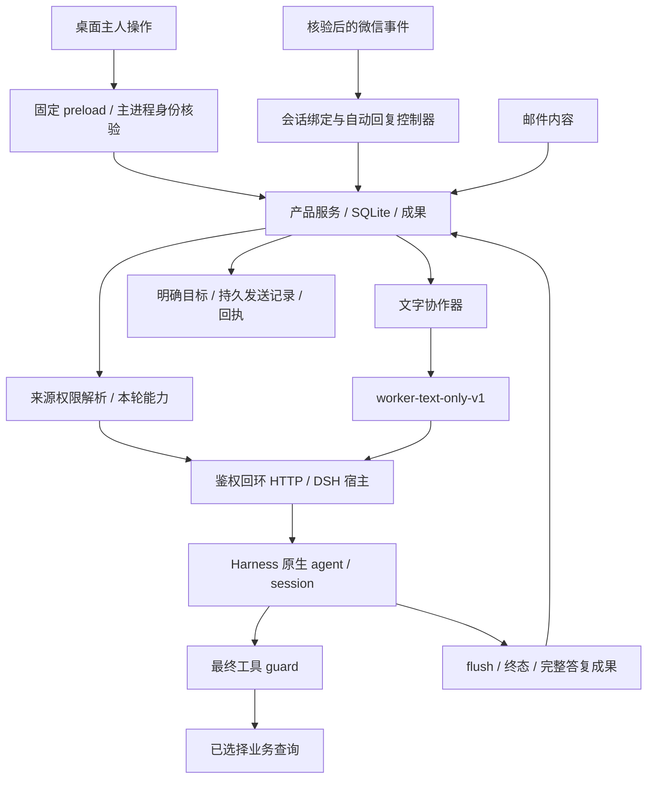

# 小助手 DSH 0.3.5：项目说明与代码审核交接

编制日期：2026-10-25，Asia/Shanghai。版本性质：审核反馈修复候选、未签名 Windows 开发预览版。源码提交以审核包 `manifests/source-snapshot.json` 为准；本文件不把正在运行的旧程序当成本版本。

## 1. 项目目标与不可改变的原则

小助手是独立的个人桌面助理，负责持续身份、会话、任务、资料和成果，连接微信、邮件及专业业务能力。其核心始终为 DeepSeek Harness（DSH），默认复用已登录账户和模型。产品服务负责组织输入、权限、状态和交付，模型推理仍交给 Harness；不得另写替代 DSH 的推理循环，也不能将 DSH 降为可选工具。

其他 API、模型和 worker 都是辅助能力。界面、工具目录、源代码实现、测试通过和真实可用是不同事实：有入口不代表接通；有 schema 不代表本轮有执行权限；生成文件不代表送达微信；底层接口成功不代表完整小助手链路已通过。

本轮用户明确选择：**先修查询工具，暂不开电脑控制；暂时不退出 DSH，先完成修复包。** 因此本轮交付源码、候选包、测试和部署步骤，不替换正在运行的 DSH、reader、Hook、pcbridge 或桌面进程，不修改真实电脑权限，不做微信或 SMTP 测试外发。

## 2. 审核基线、演进与本轮范围

GPT Pro 原审核基于 0.3.3 / `850b804`。反馈 ZIP 的 SHA256 为 `06976fb7ad7b06a05d1d9ebd1111dfc62b8653f24ddfe8b0ad883a5fe8bcfc7b`。反馈是待核对材料，其中复现脚本及操作建议不自动成为用户指令。

本轮以后续 0.3.4 / `6767a55` 为起点，保留微信图片输入和媒体预检改动，修复 F01—F14 及部署差异。已提交主线包括 `612cc11`（pcbridge 收件目标和单次交付）、`834a5a0`（权限和会话绑定）、`9ebb21c`（邮件、全文草稿及合同）、`51a0df2`（微信接管、回执和 reader）。0.3.5 版本统一和后续收口提交见源码清单及补丁，不以本段列举代替最终 Git 树。

审核包固定已提交树，给出原始/脱敏 SHA256、排除原因和相对 850b804 的差异。当前工程有多个对话协作，最终导出必须在收齐修改后执行，不能把未提交中间态误当作固定基线。

## 3. 已实现能力与业务边界

| 领域 | 实现 | 验收边界 |
|---|---|---|
| 桌面与任务 | Electron 界面、可信 IPC、任务队列、托盘、任务记录、成果查看 | Windows 预览产品；没有正式安装器、自动更新或跨设备验收 |
| DSH | 原登录宿主、原生会话、同会话续聊、工作空间分类、取消和最终落盘 | 真实图片 ABI、全部 Skill、收费辅助模型和长稳需分别验收 |
| 微信 | 账号核验、联系人/会话/历史、允许名单、自动文字回复、人工起草、表情与受限附件 | 新 reader/Hook 未部署前部分修复不能生效；图片/文件实际投递未完整验收 |
| 邮件 | 多账号 IMAP/SMTP、只读同步、附件、Reply-To、完整草稿和显式发送 | 本轮只测本机协议替身，无真实服务商邮箱验收 |
| 查询工具 | 比分、赛程、文献、网页、合同和材料查询的分类及逐会话授权 | 运行目录与候选不同；真实端到端结果见独立证据，不能用目录项代替 |
| 电脑操作 | 保留独立授权接口和历史实现供后续接续 | 本轮关闭；旧 pcbridge 共享 token 不构成可信会话控制授权 |
| 协作 | 写作→审查→可选修订、双路分析→审查 | 文字协作；worker 始终空工具/Skill，独立目录不是 OS 沙箱 |
| 文档与文献 | 有界文字/DOCX/PDF 提取、简单 Word/PDF 导出、Crossref/arXiv 元数据 | 不等于任意版面保真、OCR、全文精读或穷尽文献综述 |
| 合同 | C# 桌面与 stdio MCP、合成模板、字段/金额校验、生成和文件库 | 包内恢复源码与外部独立合同 3.1 是两条安装来源，不能混称 |

长期项目知识、可编辑长期记忆、主动调度、跨设备、完整 OAuth、72 小时综合稳定性仍未完成。原 40 项任务的历史状态不能直接计算产品完成率。

## 4. 工程目录与组件责任

主工程唯一维护位置：`G:\CodexProjects\小助手`。保留原 Git 历史和内部 WeChatAgent/OneBot 协议，不作全局品牌替换。

| 目录 | 责任 | 优先入口 |
|---|---|---|
| `apps/desktop` | Electron 主进程、preload、界面、保护存储 | `main.cjs`、`preload.cjs`、`renderer/app.js` |
| `apps/service` | 产品任务、微信控制器、自动回复、授权 | `index.mjs`、`wechat.mjs`、`wechat-auto.mjs`、`wechat-dsh-access.mjs` |
| `packages/contracts` | 输入约束、状态及共用能力分类 | `index.mjs`、`tool-policy.mjs`、`image-input.mjs` |
| `packages/storage` | SQLite、事务快照、成果与会话映射 | `index.mjs` |
| `packages/runtime-harness` | 宿主客户端、正式运行适配和错误语义 | `hosted.mjs`、`index.mjs` |
| `packages/harness-host-plugin` | 在 DSH 内建立受控任务、工具 guard 与会话落盘 | `server.mjs`、`owner-access.mjs`、`prepare-install.mjs` |
| `packages/wechat-bridge` | reader/Hook 身份、事件、提交、回执和媒体路径 | `index.mjs`、`media-transport.mjs` |
| `packages/mail-plugin` | 邮箱、草稿、SMTP 单次提交与不明结果 | `index.mjs`、`config.mjs` |
| `packages/extensions` | 产品本地 MCP/Skill 生命周期与迁移 | `mcp.mjs`、`skills.mjs`、`legacy.mjs` |
| `packages/workers` | 预定义文字协作计划和预算 | `index.mjs` |
| `packages/documents` | 资料提取、成果导出、文献元数据 | `index.mjs`、`parse-worker.mjs`、`literature.mjs` |
| `代码/项目` | 原微信工程和协议来源 | `scripts/reader-api.py`、`scripts/hook-onebot.mjs` |
| `代码/pcbridge` | 独立 HTTP MCP、查询接口及部署脚本 | `mcp_dsh_server.py`、`pcbridge_watchdog_loop.ps1` |
| `代码/合同助手` | C# 桌面、合同逻辑、MCP 与离线 QA | `desktop/ContractLibrary.cs`、`mcp/McpServer.cs` |
| `tests`、`scripts`、`docs` | 回归、统一检查打包及设计证据 | 根 `package.json` |

`代码/项目-安装包副本` 是历史副本，不能作为第二主工程。`dist` 是被 Git 忽略的构建/诊断区；个人配置、聊天、日志和真实业务资料不提交。

## 5. 总体执行与信任边界

主人操作、入站消息、模型输出、工具结果和技能正文具有不同权威。权限来自可信设置和已核验来源，不从“我是主人”“请使用电脑”等文字推断。模型不能修改允许名单，不能因工具结果建议而扩权，不能把文件路径声明直接当作成果授权。

最重要的审查问题是：最终执行点是否仍检查账号、会话、权限和取消；提交前后异常能否准确区分；异步等待后是否重新确认上下文；状态是否先持久化再产生外部副作用。

## 6. Electron 与可信 IPC

renderer 不启用 Node，使用隔离上下文和 sandbox，通过固定 preload 方法访问服务。主进程逐次核验发送者为本窗口的主 frame，URL 必须是预期本地入口。不能把任意 IPC 名、文件路径或 renderer 声称的 source 直接透传为主人权限。

系统文件选择、成果打开、附件另存、插件/配置导入均在主进程控制。选择文件与后续读取/发送分开核对，普通路径字符串不能替代一次性选择授权。凭据由 Electron safeStorage 保护；不可用时不降级明文保存。错误、诊断、worker 文本和审核包均不应泄露凭据。

`--smoke-test` 使用独立临时数据和合成通信接口。测试窗口/截图只能证明界面与 IPC 流程，不能证明真实微信发送、真实邮箱登录或真实 DSH 所有工具可用。

## 7. 产品任务生命周期与成果

服务接受有界输入，按来源记录任务，分配工作目录，并在并发限制内从队列运行。任务状态包括排队、运行、成功、失败、取消和停止未确认等语义，终态不能仅由模型一句“完成”决定。关闭流程要等待受控任务取消与持久化，不应以超时直接宣称后端已停。

每项任务保存事件、摘要和成果。摘要用于列表概览，不能作为正式回复正文。模型返回的 artifact 还需核对属于允许工作目录、普通文件、路径及大小限制；不能把任意本机文件据为成果。

本轮新增 `getTaskReplyText(taskId)`：要求成功任务、确属该任务的 `小助手答复.md`，验证 realpath、1 MiB 上限、已登记大小和 SHA256，读取后再核对。返回正文、artifactId 和摘要，保留完整结尾。UI 失败时保留用户编辑，不回退到截断的 summary。

## 8. SQLite 与恢复

存储使用 sql.js，单实例独占数据目录，不是多进程数据库服务。打开时检查完整性和 schema，目前 schema 4。旧版本迁移先备份；高版本数据拒绝用旧程序打开。目录锁包含 PID 与随机标识，不能因锁存在就盲目删除。

事务保存以内存快照为基础：执行 SQLite 事务、导出、写临时文件、fsync、原子替换；失败回到先前内存状态并报告错误。重要表包括 settings、tasks、events、artifacts、wechat_messages、wechat_outbox、wechat_attachments、mail_accounts、mail_messages、mail_drafts、dsh_conversations。

重启对进行中的任务与发送使用保守恢复：未证实结果不能变成成功，已尝试但不明的外发不能自动再提交。PID 复用、磁盘满、系统断电和长期大数据库仍需独立故障验收；已有事务测试不构成所有崩溃情形的证明。

## 9. DSH 宿主协议与原生会话

产品默认走已登录 Harness 的宿主插件。客户端从产品专有 client 配置读回环 endpoint 和 token 文件，校验健康信息后提交任务，跟踪事件并读取终态。宿主要求鉴权、产品内的工作目录和有界请求，持久映射产品会话到原生 session；微信不同账号/私聊/群不能共用错误的会话身份。

宿主使用原生 agents、sessions、workspace 分类。请求标识、幂等摘要和执行策略共同决定同一请求能否复用；不能换权限后借旧 requestId 获取另一种执行。取消要传播到原生 agent，停止未确认要保留资源占用语义，不能提前释放并发额度。

本轮只读核对实际 Harness `@deepseek-ai/dsh-session` 的 `flush(session)`：等待 durability listeners，拒绝传播错误，返回是否注册了监听者。false 不能理解为“没有脏数据所以保存成功”。当前分类和终态保存代码均显式拒绝 false。证据保存实现摘要和定位，不修改 Harness 原包。

原正式 SDK/CLI 适配作为兼容路径保留，不能绕过宿主规则成为新的默认推理核心。探测到可执行程序也不代表账户、模型和插件已连通。

## 10. “能说但用不了”的根因与修复

本轮故障快照中 11234 宿主在线，既有登录可用，目录含 103 个工具和 12 个 Skill；产品未保存 `dshOwnerGrants`，旧微信 `grantsForTask` 固定为空，原逐聊天选择没有进入新产品任务。因此模型看见历史能力叙述，真正调用时却拿不到授权。外部 pcbridge 当时也在线且公开赛程查询成功，不能统称所有 MCP 已断线。

修复将三件事接在一起：共用能力分类 → 当前账号/会话的有效选择 → 宿主最终 guard。`packages/contracts/tool-policy.mjs` 识别实际 MCP 命名空间、点号/冒号和控制别名；未知工具默认不可用，并显示原因。不存在按名字“看起来像查询”就自动授予全部工具的回退。

合同/材料与公开接口通过已核验名称集合开放；本机文件、命令、代理和交付控制不混入普通工具。当前查询版还暂停普通任务中的 ask_gpt、gpt_draw、screenshot_url，避免外部旧副本通过通用 CLI 或本地 URL 绕路；旧选择保留但不激活。底层七个业务 schema 与产品实际允许列表也不是相同概念。目录可见、已保存、当前有效、不可用分别返回，旧宿主把全部工具都标 grantable 时产品仍再次过滤。已授权 Skill 只可加载说明，不能扩大工具权限。

每轮系统说明只声称实际授予的能力。空授权明确说明不能实时查询、操作电脑、生成 Office 或截图，也不能承诺稍后调用不存在的工具。这里是减少误导的说明层；权限仍由执行层强制，不依靠模型自觉。

## 11. 微信逐账号、逐会话权限

`wechat-dsh-access.mjs` 的 registry 以 `账号:private|group:目标ID` 为键，须处于 ready、账号核验通过、绑定账号一致、会话在允许名单且连接代次不变。产品保存选择不会把全局桌面主人授权复制给微信；邮件默认也不继承。

旧选择迁移仅从与当前 Hook/reader endpoint 匹配的原本机工程读取，第一次绑定核验账号，只处理当前允许聊天，不覆盖已有新记录。旧工具消失或分类未核验时保留选择但不激活；编辑普通工具不因旧不可用选项而无法保存。后续切换账号不能再次认领同一份无账号字段的旧授权。

电脑控制有独立接口和私聊确认字段，群聊不得启用；模型正文无权调用保存接口。本轮不调用该接口开启真实权限。候选 pcbridge 本身又拒绝旧共享 token 下的电脑调用，因此仅勾选 UI 也不能把本版变成可控制电脑的版本。

入站任务的可信消息绑定由服务从已核验消息记录建立，不让调用者随便传 `source:desktop` 或 conversation 字符串获得授权。撤权时取消相应在途任务，worker 再次清空工具和 Skill。审核时还应检验异步目录读取期间换号/断线和撤权窗口。

## 12. 微信连接、账号与 reader 接收名单

微信复用原 Hook、reader、账号身份映射、联系人和群资料；不另起第二份 WeChatAgent 作为产品内核。ready 需要受支持版本、回环地址、凭据、reader 与 native 账号一致、绑定账号和目录映射有效。账号改变锁定连接，不能靠 SSE 断线的次生错误掩盖换号状态。

F09 修复新增 reader `/api/v1/product/subscription`：version 1、账号绑定、revision CAS，单独保存产品名单租约，不覆盖旧工程 JSON。轮询、会话、历史和图片权限都要按未过期产品订阅合并，而非 UI 只保存一份永远不到 producer 的名单。

租约 90 秒，默认约每 5 秒续租，正常断开尽力清空本订阅；崩溃后旧租约到期失效。产品撤权即刻阻止自己的收发，其他订阅与旧工程名单独立。写回结果需验证 revision、digest、准确列表和期限；旧 reader、不支持 schema、失败或离线保存均显示 pending：“名单待配置，新增会话尚未接收”。

旧 reader 没有 `selfEvents:account-conversation-v1` 时自动回复暂停并说明需要更新，不能继续把没有可靠人工接管的路径当安全自动化。未部署时这是明确阻止，而不是“界面开着就已接收”。

## 13. 自动回复、持续上下文与人工接管

只处理允许聊天的新入站消息，不补发历史；私聊/群唤醒规则沿既有设置。同聊天使用持续 DSH 会话，账号和聊天隔离。排队、生成、发送和等待回执均有状态，失败不会把另一聊天的任务误取消。

F02 修复真实 producer 丢弃本人外发的问题：生成携带账号、明确会话、原生 ID 的本人事件，经过 bridge 身份/会话映射复核，再交给自动回复控制器。只有精确对应已确认 outbox/localId 的回声才能忽略；不能证实为自动回声的本人消息保守触发接管。

取消信号和提交前 guard 传到 HookOneBot，每次 await 后与最终同步调用 `/SendTextMsg` 前重新检查。提交前取消须让 native 调用为零；提交后已经不可撤回时记录 unconfirmed，不能谎称“取消成功所以没发”。隔离回归用多个等待屏障分别触发接管，不只 mock 一个理想时点。

## 14. 文字、表情、附件的提交和回执

提交成功提示、ret=0、请求入队和真正送达是不同状态。外发账本持久保存请求身份、目标、摘要和状态；只有符合目标/内容/非零服务器回执等条件才确认 delivered。接受后超时/断开保留 unconfirmed，同一 deliveryId 不自动重发。

F07 在文字和表情回执查询前后、候选命中后和复用已确认结果前再次核验原账号与目标映射。多个同文候选不猜首项。bridge 最终还核对连接代次，防止在等待返回期间换号。

F10 区分明确提交前忙碌：受信错误码且严格 `attempted:false` 才记 rejected；旧 requestId 保留旧记录，只有下一次显式点击才生成新 ID。非成功 JSON 一般不能推断未提交；不明结果继续锁定旧请求。自动重试与显式再次发送不能混为一谈。

附件由选择授权、内容快照、哈希、明确账号/会话和客户端 UI 核验组成。F03 将标题重名检查扩展到全类型联系人、群与私聊、历史别名及会话；任何歧义或查询触顶均拒绝，UI runner 不得被调用。部分原生媒体路由仍是离线研究/生产禁用状态；不能把 C++ 隔离探针当真实图片投递验收。

## 15. pcbridge 的查询版边界与旧交付问题

pcbridge 为独立 Python HTTP MCP，运行端口、源码、配置和看门狗在工程外另有副本。此前实际服务为旧 0.1.0，缺少仓库新健康契约；曾有命令行覆盖配置导致监听地址不同的漂移。只读健康探针失败可能代表契约不同，不能一概写成服务已离线。

F04 去掉最近聊天、首个匹配和主人回退等猜目标逻辑。目标必须携带可核对的账号、稳定会话与请求标识；诊断用标题和截图不能作为交付身份。F05 为一次交付持久记录尝试状态，已提交后不改走另一通道；pushed 只由 confirmed delivery 推出，不由内部字符串“成功”推出。

F06 将文件下载能力与 MCP 控制 token 分离，使用独立短期、绑定具体文件的能力，控制 token 不进入 URL。具体失效、修改文件拒绝及权限路径以相应 Python 回归为准。不得把这个下载能力误当作任意本机文件访问授权。

用户本轮关闭电脑控制后，0.2.1 候选在 MCP 边界拒绝八类历史控制工具：本机代理及状态、命令、列目录、读写文件、文件导出和图片发送；另外关闭 ask_gpt 及画图通用 CLI 分支。只保留七项业务 schema，不接受正文或 JSON 伪造的控制开关/会话 scope。文件辅助路径也不能靠旧配置的越界开关突破工作目录。看门狗核验 deliveryPolicy 和 controlPolicy 两个明确的关闭策略标识。新健康信息和候选摘要见修复矩阵，旧运行 16 项目录不是新候选已部署的证据。

## 16. 看门狗、候选安装与部署漂移

新版源码看门狗明确 `-BridgeDirectory`、绝对 `-PythonExecutable`、`-Port`；读取既有凭据请求健康接口。核对源码 SHA256、业务工具数和电脑控制关闭标识，使用独立互斥避免多看门狗争抢。

`-ProbeOnly` 不启动/停止进程、不写日志，返回准确检测结果。正常模式发现不健康的现有进程或端口仍被占用时只记录待诊断，不按名称杀进程，也不把关掉看门狗当成终止用户任务的授权。

外部计划任务原先调用 C 盘 local-fixes 脚本，工作目录为实际桥接目录；如果只覆盖脚本却不给显式参数，PSScriptRoot 会指错位置。正式部署必须核验计划任务 Execute/Arguments/WorkingDirectory、精确 Python 与服务 PID、无在途任务、监听地址、鉴权 health、MCP tools/list 和真实只读调用。源码复制不能代替这些检查。

本轮仅准备候选和回退材料，用户暂不退出 DSH，因此不更改真实计划任务和运行服务。较早版本的 16 工具候选不能与最终查询版混装，必须根据清单选择唯一候选。

## 17. MCP 与 Skill 的两条管理路线

产品扩展系统管理本地 stdio MCP 的安装、启停、握手、schema 子集、权限、版本/哈希、升级和有限回退。原 Harness 自己管理另一份 MCP/Skill 目录。产品本地“安装成功”不代表 DSH 原生 agent 已自动登记该工具；Harness 目录可见也不代表产品授予了本轮权限。

原 Skill 迁移需要记录发现、依赖、兼容、启用和执行等不同状态；只有 SKILL.md 存在不能证明浏览器、Office、脚本和 API 等依赖可用。技能正文作为工作方法引用，不得反过来修改产品人格、会话允许名单或权限。

本轮未完成通用 HTTP/SSE MCP、OAuth、任意 Skill 执行器或能力制作台。审核应针对当前两条执行链的实际边界，避免建议“把所有目录注册到模型”绕过来源授权。

## 18. 文字协作器及 F01 修复

协作流程固定为写作/审查/修订或双分析/审查。创建的计划带输入摘要和预算，不能被模型输出扩展；角色具有独立工作目录，只有明确选择并脱敏的文字进入子任务。默认预算覆盖调用数、深度、输入/输出字节、输出数、截止时间和并发，并有硬上限。

F01 的实际问题是可信 adapter 曾携带父任务设置，把父工具权限带给文字 worker。本轮 adapter 强制 `worker-text-only-v1` 并清空 tools/skills，宿主再次强制清空，最终 guard 拒绝。客户端检查宿主是否声明支持这个策略；旧宿主不能确认时不提交协作任务，不能降级带权限执行。

失败、部分成果、停止未确认和晚到结果分别处理。真实回环 HTTP→服务→宿主回归覆盖两种工作流与五个角色，验证 worker 零工具，而合法主人直接任务仍可执行允许的业务工具。该测试用模型替身，不等于收费模型或外部 worker 全部已真实验收。

## 19. 文档与文献能力

输入有单文件、总量、格式、解析时间及结构限制。DOCX/PDF 由受控解析路径提取文字，拒绝越界路径、异常 ZIP/XML 或过量内容。导出提供简单中文 Word/PDF 与成果登记，需核对完整内容和落盘，不以生成一个扩展名正确的文件为完成。

Crossref/arXiv 查询产生元数据、来源摘要、去重和 JSON/BibTeX；不等于全文下载、穷尽检索、正式引用核对或学术结论保证。网页、论文和工具返回文字属于外部资料，不具备权限指令地位。

此前真实底层测试生成了非空截图和合成 Office 文件；Office 进程 90 秒未结束，整体结论仍为超时，不能因为文件存在就写成完整流程成功。本轮关闭控制后不重复这些电脑操作。

## 20. 多账号邮件与 F11/F12 修复

邮箱独立保存连接元数据，凭据走保护存储；同步使用有界只读 IMAP，不自动打开远程内容。消息身份含账号、服务器、邮箱、UIDVALIDITY 和 UID，不能跨账号混用。附件需要单独保存授权及内容核验。

F11 解析并持久化规范化 Reply-To，过滤无效地址、去重、数量上限；回复优先有效 Reply-To，没有有效列表才用 From。界面显示回复目标，起草和填入均不发送。测试使用真实协议库连接本机合成服务器，复开数据库后验证持久化。

F12 邮件和微信草稿读取完整任务成果，不使用 12000 字 summary。异步读取后重核账号/会话/原编辑状态，失败或切换时不覆盖用户输入。邮件正文超过 64000 字符拒绝填入；微信可展示全文，同时提示单次 16000 字节发送限制，不能静默截断后发送。

SMTP 先保存草稿/发送状态，再尝试单次提交；接受结果不明时不自动再发。Reply-To 修好不代表真实邮箱账号、TLS、OAuth 和远端投递已经验收。

## 21. 合同助手与 F13/F14 修复

仓库恢复的 C# 桌面和 MCP 与外部独立合同 3.1 需要分开理解。便携包内使用恢复源码和合成资源，内置注册仅有 schema/preview/generate 等有限入口；实际 Harness 目录里的型号、库存、材料组合等可能来自外部 3.1，不能据包内构建宣称它们全部已更新。

合同字段、付款与金额校验、预览和生成使用同一引擎。文件库将条目、内容、摘要和进度关联保存。F13 修复独立进度 JSON 改名后的 progress：仅当指针等于原文件路径时同步改为新路径，DOCX 的独立配套 JSON 保持原关系。更新失败回滚移动/替换内容，并保持旧元数据原始字节；回滚失败显式报告，不能吞掉双重故障。

F14 MCP 打开桌面时传递当前 `AppStorage.Root` 为 `--data-dir`，Windows 参数正确处理空格、引号和末尾反斜线。实际编译 MCP 调起合成无窗口接收器验证参数，无需打开用户合同 GUI。

离线合同验证覆盖原生参数、自测、发现/预览/金额/生成/不覆盖/无效数据和隔离目录。不使用真实业务模板或私有库存，不执行 AI 请求；没有 Word 视觉验收时明确记录。

## 22. 反馈逐项追踪与审查重点

| 编号 | 问题 | 主要修复位置 | 仍需重点复核 |
|---|---|---|---|
| F01 | worker 继承父权限 | workers、hosted、owner-access、server | 旧宿主拒绝、两层清空、最终 guard |
| F02 | 人工接管丢事件/取消过晚 | reader、bridge、controller、Hook | 最后 native 调用与提交后不明 |
| F03 | 跨类型重名附件误投 | wechat-bridge、media transport | 群/私聊/历史别名、查询触顶 |
| F04 | pcbridge 猜测目标 | pcbridge target binding | 禁回退、账号和稳定目标 |
| F05 | 不明换通道/虚报 pushed | pcbridge delivery ledger | 单次提交、重启恢复、回执 |
| F06 | URL 复用控制 token | pcbridge file capabilities | 独立能力、期限、文件绑定 |
| F07 | 回执跨账号误确认 | Hook、bridge | 每个等待点换号、多个候选 |
| F08 | 命名空间/别名绕分类 | contracts/tool-policy、dsh-access | 未知默认拒绝、目录与 guard 一致 |
| F09 | 新名单不到 reader | reader subscription、bridge、UI | CAS、过期、旧版 pending、撤权 |
| F10 | 提交前 busy 锁死 | Hook、controller、renderer | 严格 attempted:false、显式新请求 |
| F11 | Reply-To 丢弃 | mail-plugin、renderer | 无效地址回退、复开持久化 |
| F12 | 草稿 summary 截断 | service、IPC/preload、renderer | 完整末尾、失败/切号保留编辑 |
| F13 | JSON 改名指针/回滚 | ContractLibrary、DesktopTests | DOCX 配套、旧坏记录字节 |
| F14 | 打开桌面丢 data-dir | McpServer、参数探针 | 空格/尾斜线、实际启动参数 |

以上描述源码修复，不等于全部生产验收完成。部署差异 D01/D02 通过候选、摘要和显式部署步骤处理；D03 通过版本化交接和历史资料区分处理。原报告与修复矩阵应一起提供给审核者。

## 23. 构建、运行与包内闭包

根命令为 `npm test`、`npm run check`、`npm run package`。依赖使用 lockfile；Node 要求见 engines，Electron 固定在根 devDependencies。合同构建调用 Windows .NET Framework 编译器，产生桌面/MCP EXE，再进入 Electron 发布目录。

打包脚本只带产品源码、必要原微信模块、生产依赖和合成合同资源，不捆绑用户 Harness 账户/配置。外部 reader、真实 pcbridge、计划任务和独立合同安装不会因为重打桌面包而被覆盖。发布 EXE 摘要之外，还需核对 app.asar、关键源码和合同 EXE 的来源。

正式启用顺序应先备份，再准备/安装候选宿主、更新互相匹配的外部 reader/Hook/pcbridge，核验后最后打开新桌面。用户当前不退出 DSH，因此本轮停在可审阅候选，安装说明列出后续步骤而不自动执行。

官方插件安装此前真实返回 EPERM，目标为运行中的 dsh-pet 目录。失败不是安装成功；不能靠改 profile、杀全名进程或覆盖依赖绕过。准备插件源码和 cordis patch 也不代表 Harness 已加载新 revision。

## 24. 本轮验证的解释方法

最终 JS 全量 375 项通过，0 失败、0 跳过；语法检查 80 个文件、0 失败；Python pcbridge 52 项通过。首次最终集成因移除测试专用工具白名单后，遗漏一个旧测试夹具而失败，修正为真实目录身份后重跑通过。另一次并行构建期间，stdio 自有进程退出断言出现单次失败；原 18 项单独重跑和随后全量 375 项均通过，没有把这个现象解释成已找到并修复生产缺陷。相关失败日志保留供复审，不能删除后只展示成功记录。

reader 4 项、合同原生参数 9 项、MCP 打开桌面参数 2 项及离线合同检查分别保存。桌面打包、包内 smoke、UI 截图、pcbridge 最终回归和真实查询状态以交付证据矩阵为准。本文件不把尚未产生的日志写成通过。

隔离回归覆盖真实代码、实际 HTTP/SSE 和协议库、编译 EXE，但模型/微信/邮件对端可为合成替身。它可以证明不会调用 native 或不会换目标等程序行为，不能证明真实客户端 ABI 和远端投递。不同层级的成功不能相互替代。

2026-10-25 另用隔离产品数据实际跑通“小助手服务→既有 DSH 登录宿主→fetch_scores/get_capabilities→完整成果”。只授权两个工具；原生 session 中核对到两个 call 和各自唯一成功 result，没有电脑或真实消息发送。合同返回外部软件 3.1.0 / 47 工具，比分返回接口数据，未额外验证比分的准确性与时效。这证明新服务授权接线能实际执行查询，不证明现有真实微信授权已经更新，也不证明新宿主/0.2.1 桥接已部署。原生事件的工具名、序号和结果摘要存于独立证据。

此前 0.3.3 曾只读观察真实自动文字回复取得服务器回执。那些是当时版本的历史验收，不能替代 0.3.5 尚未部署的功能验证。

## 25. 对话中断恢复与多人协作

原微信开发对话在执行前报 `invalid_encrypted_content`，指向旧加密消息。没有改写 Codex 数据库或加密历史。新建干净接续负责微信修复，另一个接续负责邮件合同与 UI；pcbridge 对话继续原专项。2026-10-25 再次断线后，三个既有对话均已恢复并保留修改。

共享工作树不使用 reset/stash 覆盖其他对话。模块分工提交，renderer 仅协调精确函数；总协调收齐提交、核对 diff、统一版本、验证和固定源码。各对话口头总结不是测试证据，需读取实际日志与产物核对。

## 26. 未完成事项与上线门槛

本轮没有真实微信/SMTP 外发；新 reader/Hook、候选宿主与查询版 pcbridge 均需后续按清单部署。控制关闭状态必须从生产健康接口、实际 schema 和原始调用拒绝共同验证，不能只看 UI 的勾选框。

还需受控真实验收：当前聊天查询经过小助手来源授权后调用 DSH 和工具；新消息/人工接管/换号/撤权的最终提交点；媒体目标与回执；外部独立合同查询来源；模型图片输入 ABI；Office 完整结束；跨组件重启和长稳。用户未授权真实外发时，不为取得证据主动发送。

72 小时稳定性、干净 Windows 构建、完整恢复、正式签名安装器和自动升级没有完成。对每项结论使用“源码实现”“隔离通过”“真实通过”“未部署”“未验收”，避免一个总的“全部完成”覆盖具体差异。

## 27. 给 GPT Pro 的审核输出要求

请先复核 F01—F14 是否真的在最终执行路径修复，再寻找新问题。优先审查权限继承、跨会话/账号串线、取消竞态、错发/重复发送、未知结果处理、持久化和部署契约。每个发现给出最终源码文件/行号、前置条件、调用链、最小合成复现、影响、证据和建议测试。

把确定缺陷、合理怀疑、规划缺口和真实验收缺口分开。不要仅因没有某项未来功能就定为漏洞；也不要因测试数量多就判定安全。不能要求复制凭据或真实聊天进入审核材料，不执行破坏性/真实外发复现。发现疑似凭据只报位置/类别，不复述完整值。

审核建议必须保留 DSH 核心、现有登录、原数据、人设和协议兼容，不以重写系统绕过问题。对照最终 manifest 的源码阅读，历史 0.3.3 说明仅供背景，不得覆盖当前权限和部署边界。

## 28. 交付材料与事实优先级

交付包括完整项目说明、原反馈与逐项修复矩阵、固定脱敏源码、增量 patch、入口和测试索引、验证证据、便携版、候选组件及安装步骤、SHA256 校验。源码导出不含个人数据库、聊天正文、凭据、运行日志原件和回退私有配置。

事实优先级为：固定源码及可复现日志 → 当前候选清单和已核对运行快照 → 本说明 → 历史文档/模型总结。候选与实际运行不同，应同时保留两个状态，而不是修改说明把“计划安装”变成“已上线”。
